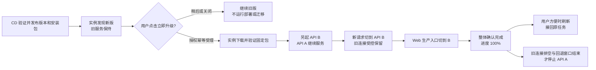
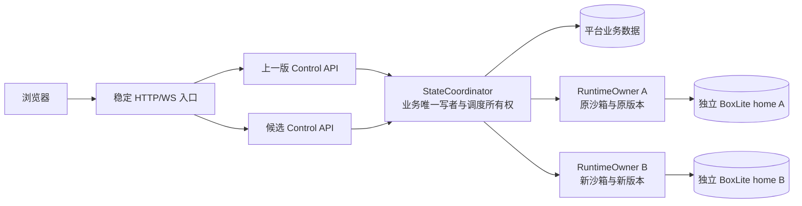
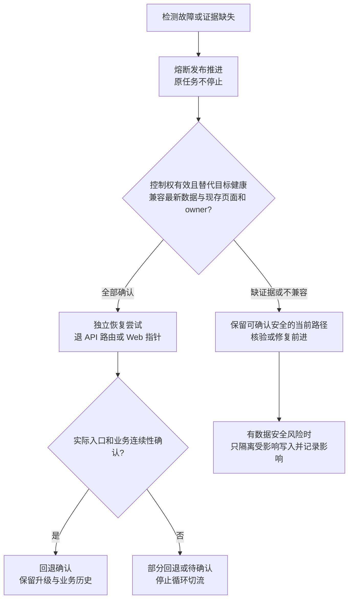

# 不停机升级与运行环境分离

本计划承接 [UPG 需求规格](../../product/requirements/UPG.md)的 REQ-UPG-001–009、共 52 条 AC，以及[产品和设计变更](../../product/changes/2026-10-10-不停机升级与沙箱续接.md)和[2026-10-18优化决策](../../product/changes/2026-10-18-升级体验与启动可观测性优化.md)。目标是常规平台发布持续提供服务，已有沙箱、交互任务、无头任务和自动化继续执行，刷新后重新连接原实例与原会话；当前服务版本、当前页面版本与升级目标常驻可查，不能用候选版本冒充已更新。

**独立角色与两实例限定升级已落地，完整正式资格分开记录。** 当前两台平台实例统一采用 Colima Linux arm64、Foundation 与五个独立角色。基础迁移及先前`.7`桥接／最终升级均已完成；当前两台服务为`v0.3.15-experiment.*.20261018.2`、schema29，本机activation8、远端activation5。原资源身份保持，CLI沿用10/17已实测的Codex `0.163.0`／Claude Code `2.1.302`，本轮没有更换镜像或新建验证Guest，见[本轮发版验收](../../testing/results/2026-10-18-升级优化发版与双实例更新验收.md)。见[基础验收](../../testing/results/2026-10-17-统一部署与在线升级验收.md)、[本次升级验收](../../testing/results/2026-10-17-CLI镜像与双实例更新验收.md)和[统一部署入口](../../ops/统一虚拟化与实例部署.md)。

本文保留 REQ-UPG-001–009／52 AC 的设计与门禁；已完成的跨升级、真实约1GB数据库和原终端证据仍是实例限定实验，不能代替真实模型Agent、完整故障矩阵和正式五类资格。2026-10-18优化已在现有章节统一定义并完成源码及本地验证，见[本轮实现验证](../../testing/results/2026-10-18-升级体验与启动观察实现验证.md)；新包与两台实例的实际Native升级、原资源对照和新界面实验已另行完成，见[本轮发版验收](../../testing/results/2026-10-18-升级优化发版与双实例更新验收.md)，不将其扩称为全部正式资格。逐 AC 联合验收仍以 [独立测试计划](../../testing/changes/2026-10-10-不停机升级与沙箱续接测试计划.md)为准。

## 0. 先看完整升级流程：谁更新、何时切换、何时停止

**当前架构已分离控制 API、业务写者与沙箱运行服务。** 兼容更新按先准备候选、验证后切流、最后排空旧控制 API 的顺序设计；已有 Guest 留在原 Owner。真实百分比是实例执行的只读投影，不能替代连续性证明。首次基础迁移存在维护间隔，不能用它证明常规在线升级已通过。

**本轮已确定：CD 只发布版本和安装包，当前实例是否、何时升级由单个通过已有访问保护的操作人决定。** 当前实例的自动 deploy／promote 已停用；CD 不具有代替管理员执行实例升级的授权，见 0.1。目标中有三个独立动作：**CD 发布不可变产物 → 当前操作人点击“立即升级” → 当前实例升级确认完成后，该操作人自主刷新页面**。检查版本、打开提示、关闭／稍后和跨日提醒均不启动升级，不新增多人或跨实例协同流程。

“立即升级”会提交本实例的授权升级命令；“刷新页面”只加载已经在本实例激活的前端、接回原任务。下文目标流程中的 controller 指实例本地升级控制器，CD 不向它发送自动部署命令，也不持有实例运行控制权。一次明确发起的升级内可执行已定义的安全熔断／回退；失败后重试、新目标或另一次收缩升级需要用户重新发起，不能由 CD 或定时检查代替。

### 0.1 当前部署与操作边界（current）

当前服务运行在 macOS 宿主的 Colima VZ 嵌套虚拟化 Linux arm64 中。Foundation 承载 StableEntry／Supervisor，ControlAPI、Web、StateCoordinator、RuntimeOwner、Installer 分别运行；业务库由 Coordinator 单写，Guest 与终端由原 Owner 持有。远端`.3`／activation1是基础迁移的历史起点；目前两台已完成本轮`.15`实验升级，见[当前升级结果](../../testing/results/2026-10-18-升级优化发版与双实例更新验收.md)。

| 动作 | 当前边界 |
| --- | --- |
| 合并／CD 发包 | 只产生经过验证的不可变产物与目录，不自动部署实例、不切 API／Web |
| 查看版本／关闭提醒 | 只读，不产生升级 attempt、不安装包或运行迁移 |
| 管理员主动升级 | 复用已有访问保护，校验会话、CSRF／Origin、实例绑定、目标、requestId 与 generation／CAS 后才由实例 controller 受理；无额外密钥 |
| 页面刷新 | 只加载已激活 Web 并接回原书签，不重新创建或执行任务 |
| 首次基础迁移 | 本轮已经完成，实际维护时间节点单列，不视为跨升级连续性通过 |

远端catalog初始为空是基础迁移时的历史事实；[CLI发包和现场升级](../../ops/2026-10-17-Codex与ClaudeCode升级发包计划.md)现已完成实例限定演练。五类完整正式资格仍为not-run，稳定Latest未提升。运维一律使用[统一部署指南](../../ops/统一虚拟化与实例部署.md)，不重新启用自动部署作业或绕过角色管理直接替换。

### 0.2 组件更新边界与待验收能力

| 组件 | 常规发布怎么更新 | 原任务的关系 |
|---|---|---|
| CD／版本分发 | CI 通过后发布不可变 manifest、安装包／镜像、校验信息及版本目录；不访问生产实例、不迁移数据、不切其 API／Web 入口 | 新版本发布不改变任何实例版本或已有任务 |
| 实例升级控制器 | 只在本实例用户明确发起且服务端授权／幂等受理后，固定目标并下载、验证、迁移、部署及切换 | 版本检查只读；每实例独立选择升级时机，同一实例一次只能有一个有效升级 |
| 前端 Web | CD 打包；用户发起后实例准备版本化 Web 产物，验证后由实例切自己的入口／指针 | 已打开的旧页面继续工作，用户方便时刷新；刷新接回原任务 |
| 控制 API | 用户发起后，旧版保持服务，实例另起新版控制 API，验证后把新请求切过去 | API 只负责访问和编排；停止排空后的旧控制 API 不停止沙箱 |
| 沙箱运行服务 RuntimeOwner | 普通 API／Web 发布保持原服务；确需新版时另建独立运行服务，供新沙箱使用 | 原沙箱、VM、进程、终端仍归原运行服务；不热搬或重启已有任务 |
| 状态与调度服务 StateCoordinator | 普通 API／Web 发布保持运行；自身升级另做唯一写者和调度权交接 | 同一任务只有一个写入／监控所有者，自动化不因双 API 被执行两次 |
| 数据库迁移 | 先发布兼容桥、并存结构与分批回填，再切新读；回退窗口关闭且旧依赖退出后才独立删除旧结构 | 不兼容目标先拆成兼容步骤；无法证明在线安全的步骤延期，不恢复旧整卷覆盖新数据 |

因此，“升级后端”必须先说清更新的是**控制 API**、**运行服务**还是**状态服务**。它们不再随同一个容器一起停止；普通更新不要求把已有任务迁到新版运行服务。

### 0.3 一次前后端共同更新的执行顺序（planned）

下表是目标实例升级流程，只有 §9 的分离、授权受理、兼容和连续性门禁完成后才能启用。假设旧组合是 Web A／API A，新组合是 Web B／API B，原任务始终留在原运行服务。CD 发布目录的 tag 不是本实例当前版本，发现可安装包也不是本实例已经开始升级。

| 顺序 | 执行者与动作 | 此时前后端怎样提供服务 | 何时停旧进程／用户可做什么 |
|---|---|---|---|
| 1 | CD 完成三仓 CI、兼容／连续性验收，发布 API B／Web B 安装产物及可信 manifest | 每个实例仍运行自己的 Web A／API A；CD 不修改其实例数据／入口 | 不停实例；不显示实例升级百分比 |
| 2 | 实例只读检查目录，核验来源、架构和升级路径，展示“发现新版本” | Web A／API A 正常服务，目标 B 是“可安装、尚未升级” | 用户可关闭／稍后；不下载完整安装包、跑迁移或启动候选 |
| 3 | 已通过已有访问保护的用户点击“立即升级”；API校验授权／CSRF、最终目标digest、expected activation generation与requestId，原子受理 | 服务仍A；持久化本次用户意图、最终目标与固定兼容链，技术attempt分别留痕 | **这是实例升级的开始**；重复点击只关联原request及同一用户计划，不重复执行 |
| 4 | 实例控制器按冻结顺序内部完成兼容桥和最终包；各节点保留独立熔断策略、回退范围与真实确认 | API A继续服务；原owner保持；中间确认不宣告用户计划完成 | 签名／digest／架构／迁移预算失败就熔断或延期，不循环重试或要求用户再点一次 |
| 5 | 实例准备尚未激活的 Web B，另起 API B 候选，核验认证、真实业务、原任务寻址与连续性 | 生产仍 Web A／API A；候选独立监听，不另启动迁移／scheduler | 候选失败保持旧服务；候选 healthy 不等于升级完成 |
| 6 | 稳定入口把新 HTTP／WS 连接灰度切到 API B，观察真实业务 | Web A 开始使用 API B；API A 原有 WS／在途操作受控保留 | **切流量时不先停 API A**；短重连只附着原任务 |
| 7 | 观察通过后，实例把自己的 Web 入口切到 B，核对路由、产物、兼容及整体激活并提交完成事实 | 此实例 API B／Web B 已激活，其他未升级实例仍 A；原浏览器页面仍 A | 确认全部完成才显示 100%；仅页面实际不同且 Web ready 时提供“刷新页面” |
| 8 | 当前操作人自主刷新，核验实际 Web B、有效访问会话与原任务／终端清单 | 沿原 sandbox／task／终端身份重新附着 | 不部署、不新建、不重跑；若复用相同 Web artifact 就不要求额外刷新 |
| 9 | 实例完成旧请求／连接排空，回退保留窗口结束后退出 API A | API B 承接流量；原运行／状态服务仍运行 | 只停止旧控制 API；独立 contract／新版本升级由用户另行发起 |

第 3 步和第 8 步是两次不同的用户动作：前者授权升级整个实例，后者只更新自己的浏览器；不以某个用户刷新推断实例升级获授权。第 8 步可发生在第 9 步前后，也可不刷新，不是服务升级成功前提。第 9 步是本次授权范围内的受控清理，100% 不表示回退容器均消失；破坏性 contract 是另一计划／用户发起，不能借“清理”偷偷执行。旧 WS 优先自然排空，必要重连只关闭连接并附着原任务，不向终端注入 Ctrl-C／exit 或 cancel；兼容窗口内旧页面继续可用。

**整条常规兼容发布流程不安排平台整体停机。** 这要求新 API 在旧 API 退出前已承接业务，原运行／状态服务生命周期独立；不能用直接停止角色代替候选验证、受控切流与连续性验收。

### 0.4 什么时候需要停机，什么时候只停止旧进程

| 变更类型 | 当前或目标处理方式 | 停止的对象与时机 |
|---|---|---|
| 改造后的普通控制 API 更新 | 按 0.3 另起、验证、切流、排空 | 新 API 服务后才停止排空的旧控制 API；平台不整体停机，原任务不停止 |
| Web 独立更新／文档更新 | 内容指纹证明 API 未变则复用原 API；无运行产物变化的文档只更新追溯记录（均 planned） | 不停止 API／运行服务；Web 只切产物入口，已有页面不被自动刷新 |
| 新版运行服务上线 | 新运行服务有独立 home／容量，只接新沙箱；旧服务不再接受新分配 | 原任务继续留旧服务；所有活跃与保留环境的后续归属确认后才能退役旧服务 |
| 状态／调度服务自身升级 | 单独验证写入、调度、任务监控所有权的交接，API 不承担这个交接 | 新所有者安全接管且在途写入处理完成后才停止旧所有者；无法证明请求连续则延期，不承诺直接在线替换 |
| 最终结构不兼容的数据库变更 | 优先按 §7 分兼容桥、影子结构、回填、读切换、独立收缩，多次在线发布完成 | 不以“不兼容”为由直接停库；仅无法证明连续性的残余步骤延期或另列最小维护，不停止原任务 |
| 宿主／VM／内核／KVM 重启 | 从普通在线发布剥离，单独列维护方案与影响范围 | 可能真实停机或影响任务；不能当作“无感升级”，也不能仅为了发版擅自停止任务 |

“排空”是停止向旧服务分配新连接／新任务，让已有工作继续并完成安全归属；不是发一个 stop 命令把正在跑的任务清零。旧运行服务还有用户保留的环境，即使 running 数为零也不能直接删除。

### 0.5 切换失败时，前后端怎么退回（planned）

上线前必须验证四种组合：Web A／API A、Web A／API B、Web B／API B、Web B／API A。旧页面支持新 API 是切换后的正常状态；新页面支持旧 API 是 API 回退时的必要条件。它们覆盖认证、REST、终端、任务事件和数据兼容，不仅是 `/health` 成功。

| 失败位置 | 能安全执行的处理 | 原任务怎样 |
|---|---|---|
| API 候选验证或前置准备失败，尚未切流 | 不切生产入口，继续 Web A／API A，记录未完成及最后真实进度 | 原运行服务及任务保持 |
| API 已切到 B、Web 还未切换 | 只有回退兼容证据成立时才切回 API A；继续当前数据库，不恢复旧整卷 | 原身份、数据和日志游标保持 |
| Web 入口已切到 B，后续验证失败 | 根据实际失败组件退 Web 指针或 API 路由；API 回退必须兼容已经打开的 Web B | 退 Web 指针不会把已有浏览器的 B 代码改回 A，任务仍接原实例 |
| 已产生不兼容数据、旧版不能安全接回或观测未知 | 熔断发布推进；按 §6.3 核验回退资格，没有证据则不盲退，保留已确认可服务路径并按 §7 修复前进 | 不为“回滚成功”覆盖业务数据或停止任务；原运行健康未知时如实标未知 |

**熔断是停止这次发布继续造成影响，回退是把入口退到经验证能处理当前业务的产物。** 熔断不等于关闭整个平台，也不等于回退已经成功。全过程的触发条件、回退顺序和恢复门禁见 §6.1–§6.5；数据库兼容窗口和不可逆边界见 §7。

### 0.6 首次迁移的实际范围与后续验证

两台平台实例已统一到分离架构，远端来源服务已封存退役。本次在没有存续用户 runtime handle／活跃 AgentTask 的条件下导入业务数据，再验证新的真实 Guest 和终端；它没有证明任何既有活跃 VM 可跨运行服务热搬，也不补足跨升级连续性资格。

后续升级保持已有资源的真实归属；无法证明兼容、唯一写者或原会话连续时延期，不停止用户任务。完整数据、时间节点和未执行范围见 [验收报告](../../testing/results/2026-10-17-统一部署与在线升级验收.md)。后文 §3–§8 保留角色、协议、恢复和迁移的设计约束，§9–§10 规定逐项验收依赖。

## 1. 当前事实与问题边界

| 当前事实 | 已有证据与限制 |
| --- | --- |
| Foundation 与五角色分离 | 远端实际精确五角色 running，挂载来自 Linux 命名卷和运维 socket；不把控制 API 退出等同于 Guest 生命周期变化 |
| 实例身份与版本 | 独立instanceId／channel、固定信任根；两台最终`.7`／ready1／schema29，本机activation6、远端activation3，包、页面及角色身份已核对 |
| 用户升级授权 | 2026-10-17 修订为已有访问会话、CSRF／Origin、实例绑定和requestId／CAS；取消独立升级密钥／grant门槛，部署状态以发版回执为准 |
| 数据导入 | 已核对封存数据、主密钥、允许路径转换及 schema 28→28；原数据历史保留，不代表活动资源跨 Owner 迁移通过 |
| 真实业务 | `.7`跨升级原Guest／PTY／同书签与shell保持、Cookie／reload通过；约1GB真实schema28→28→29隔离场景通过，无真实模型Agent验收 |
| CD 与资格 | 自动deploy／promote已停用，CD只发布包；四份`.7`prerelease和Installer完整SHA下载通过，正式矩阵仍待独立验收 |

基础证据见[10/17基础验收](../../testing/results/2026-10-17-统一部署与在线升级验收.md)，跨升级及CLI证据见[本次升级验收](../../testing/results/2026-10-17-CLI镜像与双实例更新验收.md)。[SQLite WAL](https://www.sqlite.org/wal.html)的单writer约束仍适用：增加API进程或替换数据库不会自动解决写入、调度、任务pump和Owner归属。不同Owner的home、角色密钥及生命周期分别控制，不能因为SDK支持detach就承诺跨容器／跨Owner热搬已经验证。

## 2. 不可被发布动作改变的业务事实

1. 常规 Web/API/主仓发布不向已有 sandbox 或 job 发 stop、destroy、kill、cancel，不暂停用户自动化，不改运行中沙箱的 image digest、CLI/runtime 版本或工作区绑定。
2. 沙箱身份为原 sandboxId、providerHandle、runtimeOwnerId；交互身份为原 tmux Agent 会话和 shellId；无头身份为原 AgentTask ID/runId/jobHandle。连接 attachmentId、连接凭据和协商 token 可以变化，不代表创建新业务实例。
3. 刷新/重连只执行 attach、查询和订阅，不执行 create/start，不重发初始 prompt，不回放断线期间未确认的终端输入。可公开的终端 bookmark 只是寻址数据，不能充当凭据。
4. cookie/session 签名密钥不因常规发布轮换；已有有效会话继续有效，不要求用户为升级重新输入口令。真正过期、主动撤销与安全密钥轮换按原认证流程处理，并与发布提示分开。
5. 连接可用性、任务生命周期和运行环境健康度分别投影。观测缺失时返回 unknown/recovering，不能因 API 断开将任务改成 failed/stopped，也不能未确认就宣称“仍在运行”。
6. 运行恢复不得重置任务 cursor/fromSeq、stdout 长度、取消意图、硬超时起点和已完成的结果。用户原有时限仍生效；升级不是延长或取消任务的理由。
7. 无法保持这些不变量时保留旧服务并延期该次发布；不得将用户业务清空、强制刷新或人工停止作为“发布成功”的条件。

## 3. 目标进程边界与所有权

以下逻辑角色已在统一实例中落地，运行于同一 runtime VM，具有独立容器生命周期、PID/cgroup 和受控内部连接。常规版本更新及故障场景仍须逐项实测，不因角色存在就授予全部连续性资格。

| 角色 | 独占责任 | 常规 API 发布时的行为 |
|---|---|---|
| 稳定入口 | 认证/Origin 边界、HTTP 候选路由、WS 新连接目标和旧连接 drain，入口配置原子切换 | 保持监听和有效会话，不重建整个 Tunnel/DNS/runtime VM；失败回原 API 路由 |
| Control API | REST/MCP/WS 协议、应用用例编排和视图；通过内部端口使用业务状态和运行环境 | 不直接 new BoxLite、不本地启动 scheduler/pump、不在 bootstrap 迁移；候选先验证再接流量 |
| StateCoordinator | SQLite 阶段的平台业务唯一写者、资源/自动化调度、任务 pump 的租约与 durable 日志游标、Outbox 投递所有权 | API 切换不重启它；自身版本切换必须先完成 drain、单写者与 generation 交接测试 |
| RuntimeOwner | 每个 home 的唯一 SDK owner、实际 shim/VM、guest job、PTY 附着与最小只读运行证据 | 保留所有既有环境；新增 owner 独立 home；已有 sandbox 始终路由原 owner |
| 独立 migration runner | 当前实例的一次性迁移计划／租约、兼容检查、预演与审计；生产 DML／DDL 和 checkpoint 经 StateCoordinator 单写通道提交 | 不由每个候选 AppModule 启动，不成为第二个生产写者；不把有活跃 writer 的整卷复制恢复当普通回滚 |

SQLite 阶段先让 StateCoordinator 成为唯一业务写入入口，Control API repository/UoW 改经内部端口。RuntimeOwner 写自己的 BoxLite 元数据和 guest job 文件；平台业务表、平台日志 cursor 与所有权记录由 StateCoordinator 受控提交。跨业务状态与运行动作采用持久化操作记录和幂等结果，不能假设 guest 动作与 SQLite transaction 是同一事务。

多 Coordinator、跨机写入或 PostgreSQL 是后续选择；不以“换库”替代当前唯一写者、调度租约和 RuntimeOwner 边界。单机下仍需 generation/fencing 防止旧 owner 恢复后继续写。

### 3.1 唯一执行所有者与 fencing

拟新增持久化 owner registry 与操作记录，字段至少包括 instanceId、ownerId、role、generation、lease 状态、protocolRange、assigned sandboxId、operationId。具体表名、TTL 与索引在实现 PR 中完成容量和故障实验后冻结，不在本计划虚构迁移 SQL。

- 注册先核对实例归属、home 身份和角色，不能因为候选 API 同连一个卷就推断它拥有原 box。
- scheduler、automation trigger、AgentTask pump、Outbox publisher 分别只有一个有效 generation；API 候选没有自动领取这些角色的权限。
- StateCoordinator 在同一 transaction 内检查 generation 再提交状态/游标/配额；过期旧进程不得提交“最后一次写”。lease 到期只给出待核查状态，不能直接 stop/delete 原 VM。
- RuntimeOwner 在 side effect 前校验 operationId、sandbox assignment 与 generation；已完成操作返回同一结果，重试不能起第二个 job 或重复初始 prompt。
- 业务停止与销毁要求明确用户请求的 operationId、actor 和对应授权；部署 controller 的身份不拥有用“解阻塞”为由停止用户业务的权限。
- 持有 SDK home 的 RuntimeOwner 不在 lease 丢失后立即被另一个进程接管同 home。旧进程/锁状态核验失败时保持 unknown，避免双 owner 或误回收。
- 平台日志 append、cursor、stdoutBytes、event seq 由一个 pump 写入；原有 append→cursor 持久化顺序及恢复截断规则继续有效。

显式用户删除项目留下的持久清理队列同样由唯一 Coordinator 执行，整个异步清理捕获业务写者 epoch。交接先暂停该队列并确认已发出的清理已排空；仍有在途清理时延期交接，不强停原任务。保留的旧 Coordinator 定时器不得继续发 SDK 动作，旧回执也不得删除新写者的队列记录或工作区。已证明完成销毁的资源不再次调用 SDK；兼容旧待清理记录时，只接受原 Owner 私有账本中 provider、原资源 ID、sandboxId 精确匹配的销毁证明，并为当前 operationId 持久化完成回执。未知、缺失或错误归属不能冒充已销毁，丢失响应只查询原意图。

用户明确销毁沙箱或删除项目时，在同一业务事务中清理对应终端书签；迟到的 attach 不得重建已删除沙箱的书签。升级与普通连接断开不触发此清理。以上使用现有表和生命周期端口，不修改已发行迁移或伪造全局 schema 版本。

## 4. 拟议协议与契约实施边界

### 4.1 内部运行与状态协议

内部协议仅在受保护的 Unix socket 或 loopback 网络暴露，使用实例绑定的认证和角色授权；浏览器不直连 SDK、BoxLite home、Docker socket 或内部 owner 控制面。下列为消息草案，无既有 HTTP path 或 OpenAPI 注册含义。

| 消息草案 | 必需信息 | 语义 |
|---|---|---|
| owner.register / owner.observe | instanceId、ownerId、generation、protocolRange、home identity、capacity | 注册与只读观测；不建 VM、不接管别人的 home |
| sandbox.attach / terminal.attach | 原 sandboxId/providerHandle、ownerId、kind、原 shellId/bookmark、尺寸、protocol revision | 校验 running 与归属后附着现有 tmux；新 attachmentId 不改变任务身份 |
| task.observe / task.read | 原 taskId/runId/jobHandle、provider cursor、wait budget、有效 pump generation | 读原 job，不重跑命令；对外仍映射 taskId/fromSeq，内部 cursor 不泄露给客户端 |
| operation.submit / operation.result | operationId、actor、generation、sandbox assignment、command type、结果摘要 | 跨连接幂等；stop/destroy/cancel 与部署动作权限分开 |
| owner.drain-admissions | ownerId、expected generation、理由和剩余 assignment 数 | 只停止向旧 owner 分配新沙箱，已有 job、PTY、自动化继续执行 |
| release.prepare / release.switch / release.observe | releaseId、三仓 SHA、运行内容指纹、兼容范围、旧新 API identity | 候选验证与原子路由切换；不等价 sandbox 生命周期动作 |
| upgrade.request / upgrade.lookup | 已有访问会话的actor、实例绑定、requestId、最终target releaseId／manifest digest、expected activation generation | 用户显式发起、服务端授权与幂等受理；本轮新增用户operation承载固定兼容链，技术attempt保留；不接受任意下载URL／脚本 |

RuntimeOwner 对 stopped/unknown sandbox 的 attach 不执行 native exec 隐式启动；只有用户明确 start 用例可改变停止状态。确需读取已停止 sandbox 产物时采用独立、可说明的只读路径，不把“读文件”变成重启既有实例。

### 4.2 用户可见状态草案

拟增加 releaseId、availableWebRevision、API compatibility range 和恢复连接的原因投影，接入现有系统状态、工作台连接条与事件流。暂不决定新建端点还是扩展既有响应：实现前先完成端点/权限设计，再同步 `docs/shared/10-接口契约与类型共享.md`、后端暴露规格、真实 OpenAPI 和 Web codegen。

terminal reconnect 保留原 shellId；shellId 仅由认证后的终端清单和本页内存承载，不能直接加入浏览器 persist 白名单。可持久化的终端选择只使用独立、无授权能力的公开 bookmark，接入时重新校验认证、sandbox 归属及原会话是否存在。原 socketSessionKey 不持久化、不作为跨 owner 凭据。task reconnect 保留 taskId/fromSeq；完成任务在重订阅后仍收到原 exit。版本不兼容引导自主刷新，不重试相同不兼容协议，不发送假的 task exit。

cookie/session 密钥挂载、Origin 白名单、CSRF 与 WS 校验在旧新 API 间保持一致。普通发布更新只改变代码身份；明确的认证撤销不能由候选 API 使用另一份密钥误触发。

### 4.3 当前服务、当前页面与升级目标的可信来源（既有投影与本轮增量）

本节承接REQ-UPG-009。当前`GET /api/system/upgrade/status`和request／lookup已提供实例ledger、attempt、历史确认版本及真实Web投影；`/api/system/version`仍是实际API身份，不代表整体release。2026-10-18补齐轻量快照、用户级固定兼容链和独立服务可用性，见§4.6；这些增量已在本轮源码实施，尚未随新包上线。

CD 的版本目录记录产物已发布；实例升级 controller 通过 StateCoordinator 的唯一写入入口记录本实例激活 ledger，二者不得互相替代。ledger 至少记录 instanceId、用户 actor／requestId／授权受理时间、固定目标 releaseId／manifest digest、attempt 与单调 generation、三仓 SHA、实际 API／Web artifact、实例入口绑定、兼容结果、阶段与确认时间／失败回退原因。原 RuntimeOwner 的真实 artifact／protocol／assignment 不随新版控制 API改号；CD 无权写入实例激活事实，版本查询不推进 ledger。

| 产品字段／投影草案 | 真实来源及显示条件 |
|---|---|
| 当前服务版本 / confirmedServiceRelease | 本实例受信激活 ledger 已核对当前 API 路由、实际 artifact（包括合法复用）、生产 Web 入口及兼容/连续性证据后确认的整体 release；不能用 `/api/system/version.version`、仓库最新 tag 或另一台实例的版本替代 |
| 当前页面版本 / loadedWebBuild | 当前浏览器实际加载的不可变公开 Web build manifest，含 webRevision、artifact 身份及有验证映射的发布标签；拟在 Web 构建流水线注入并校验。无标签映射时明确构建身份/待确认，不回退到 package.json；动态服务查询不能替旧标签页提前改号 |
| 升级目标 / targetRelease | 用户选择并已受理的固定 release／manifest digest；尚未发起时只有 availableRelease，不虚构 target attempt。进行中／失败保留当时目标及原因，新目录版本不擅自替换它 |
| 可安装新版本 / availableRelease | 只读分发目录经信任／manifest digest、架构、当前 schema／最低版本链、协议和渠道核验后的目标；尚未下载或部署，无 attempt／百分比。仅 GitHub latest、tag 存在或 Web READY 不足以允许安装 |
| 新页面可用 / availableWebBuild | 用户发起的本实例升级已整体激活确认，目标 Web 实际绑定此实例入口且兼容原会话，并与当前 loadedWebBuild 不同；CD 发布包／另一个实例完成／Vercel staged 均不能提供本实例刷新资格 |
| 更新状态、最近确认时间 / observedState | 区分检查中、准备中、新页面可用、已更新、延后、未完成、熔断、回退中、回退确认和待确认；以本实例 generation 与确认时间处理查询/事件竞争，迟到旧响应不能覆盖新确认 |
| 升级进度 / upgradeProgress | 受权 controller 已进入的本实例发布尝试；含 attemptId、generation、sequence、阶段、已完成/总工作量、percent（可为空）及观测时间。只有真实工作完成证据可推进，单独 staged receipt 或候选健康不能生成正在升级或完成的结论 |
| 熔断／安全恢复 / recoveryState | 原 attempt 的熔断证据、实际组件状态与独立 recoveryAttemptId／recoveryPlan／新 generation；区分回退中、确认、部分回退／待确认或修复前进。历史实例激活／100 不证明当前仍可刷新，不用回退完成量覆盖原升级进度 |

现有 `project-release-current.json` 属于当前 CD 发布历史，目标模式中目录的 `published` 只代表版本／安装包已发布；本实例完成状态草案为 `activation-confirmed`。实例当前版本必须来自自己的激活记录；不能把目录新版本、CD 成功或其他实例激活写成本实例已升级。IP 自托管 Web 的稳定入口绑定本地固定 artifact，版本化资源路径在兼容窗口保持可读，旧标签页的懒加载 chunks 不因切换被删。

CD 不再 promote 共享生产 Web alias。如果保留托管 Web，只发布不可变版本 URL／artifact，由各实例升级控制器维护其独立入口映射并留实际绑定证据；不能让所有实例访问一个随 CD 自动推进的 `latest` 页面。具体实例 Web 部署方式须在实施 PR 验证，不能拿当前全局 Vercel promote receipt 充当所有实例升级证据。

- 候选未接流量且失败/延期时，旧服务经核验仍承接业务才显示“继续使用 vA”。部分组件已切换、整体尚未确认时显示“切换中／待确认 · 上次完整发布 vA”，不把旧版或目标新版强填成当前整体事实；发布文件写入失败也不能覆盖真实入口观测。
- 当前服务可以已为 vB，而旧标签页实际仍为 vA；卡片分别显示并说明“当前页面尚未更新”。新页面可用才提供刷新动作，点击按钮本身不推进 loadedWebBuild；刷新仍命中旧产物时保留 vA 并给版本重新读取出路。
- 同一个 Web artifact 被复用到新整体 release 时，不凭 release tag 变化通知相同页面再次刷新。首次无版本证据显示未知；读取失败保留最后已知值并标“上次确认”及时间。没有经核查的目标写“暂无可用更新”，只有更新源已成功核查才可说“已是最新”；不为查询默认外呼 GitHub latest。
- API artifact 复用仍报告其实际 APP_COMMIT/version，存量 owner 仍报告旧运行环境身份。整体服务 release 更新不代表所有组件或已有沙箱换版；维护证据保留上述关联，默认产品卡只展示版本、阶段、时间与脱敏原因，不暴露 owner、PID、凭据或整份私有 receipt。
- 版本投影／订阅按原访问保护只读；检查、关闭／稍后、次日核验和页面刷新不获取 deployment token、不安装或执行业务生命周期命令。唯一写命令是已通过当前实例访问保护的操作人明确发起 `upgrade.request`，由服务端校验并委托本地 controller；浏览器仍无 Docker／运行凭据、任意脚本或备份恢复权限。复用本实例原访问会话及 Origin／CSRF 边界，不要求升级专用密钥或二次授权；不新增用户管理或 RBAC，真实身份与实例错配仍须拒绝。发布签名、固定信任根及内部角色 RPC 密钥仍由系统管理，取消用户密钥不削弱这些内部认证。`canAuthenticate` 仅供旧客户端兼容，固定为 `false`；新界面不调用兼容 access 端点获取升级权限。

既有落点为API目录／实例版本投影与升级受理、Coordinator的request／attempt／激活ledger、独立controller及入口核验、CD发布manifest／Web build identity和Web升级交互。本轮在其上增加轻量快照及用户级兼容链，不替换真实版本来源。核验可安装release才显示“发现新版本／立即升级”；明确受理后才显示执行进展；只有最终目标实际完成且页面不同才刷新。

### 4.4 升级百分比的真实进度投影（planned）

百分比表示**用户已发起并被本实例受理的升级计划**，不是 CD 构建／发包的百分比。发现 availableRelease 尚无 attempt，不显示 0% 或正在升级；只读检查不会创建计划。实例 controller 在授权受理后固定下载／校验、兼容迁移、候选、切换和激活工作量，无须更新的组件据真实复用证据处理，不中途改分母。执行器以实际 bytes／批次／完成证据，经 StateCoordinator 确认后计算加权比例；无可量化总量时显示阶段待确认，不按时钟计数，也不把页面资源加载／原终端重连算入升级。

当前底层attempt将固定步骤权重设为1；存在尚未取得完整提交receipt的未知工作量时，整体percent为null。2026-10-18保留此真实总量语义，另投影当前步骤的completedWork／totalWork／percent及已完成步骤：下载总字节已知时仍可显示下载进度，不受后续迁移未知总量遮蔽。不同阶段的bytes、请求数与批次数不能相加解释为真实总工作量；用户计划不人为分配固定权重。灰度`weights=[1,5,25,100]`仅是流量档位。桥接attempt真实100保持历史，但用户计划在最终目标整体确认前不得显示100%。

私有升级进度与失败回执携带完整连续性／Owner调用审计，不依赖普通JSON请求的100KiB容量。当前共享bootstrap在Nest默认parser之前为 `/internal/upgrades` 单独设置24MiB有界接收；超限返回413且不进入升级ledger，不能丢弃必要证据后继续宣称安全。公开接口容量不随此修复扩大，内部身份／实例／fence／CAS仍逐请求校验。Controller把DOM timeout／abort归一为文本原因，不能将数值DOMException.code当有效业务错误码；响应不明时保留精确持久事件及原资源，不能更换eventId绕过去重。

- 只读投影至少绑定 instanceId、attemptId、generation 与单调 sequence；阶段、工作量、百分比和观测时间来自同一已提交快照。拒绝跨实例、未授权写入、旧 generation、重复或迟到 sequence、负数／非有限数、超出总量和 0–100 范围的数值；不让浏览器自行拼接另一目标的进度。
- 长步骤等待期间，当前升级执行器在成功续租后可重新读取并提交同一持久checkpoint的真实观察。观察sequence与时间可以更新，已完成工作、分母、百分比及原步骤回执保持不变；进度提交与工作提交按同一短队列顺序执行。停止续租、失去执行权、进入终态或移交后不继续上报，页面仍按原陈旧门槛显示待确认。此行为复用既有progress协议，兼容升级前已打开的旧页面，不新增用户步骤或数据结构。
- 同一进行中的尝试，确认工作量与百分比单调不倒退；新尝试有新身份和新计划，可以从 0 开始，不能沿用失败尝试的百分比。总量、阶段或证据不一致时显示待确认，不用取历史最大值掩盖数据冲突。
- 进行中数值限制在 0–99。只有本次必需工作已完成、整体激活已确认、实际生产绑定及目标 Web 可用、兼容和连续性证据均满足后，才提交完成快照和 100%，随后提供可用新页面的自主刷新。100% 不提前改变浏览器实际 loadedWebBuild，也不说明原终端已经重连。
- 部分入口正在切换而整体激活尚未确认时，当前服务为“切换中／待确认”，同时保留上次完整 release；不能因为进度达到 75% 或 95% 就报告服务已为目标版本。设计稿的 20／45／75／95／100 及阶段只是固定示例，不规定正式发布的权重。
- 已确认发布正在执行但暂缺工作量时仍可展示进行中阶段及未定进度条，不伪造数值。观测超出发布策略规定的有效期、连接失败或状态来源不可确认时，进度转待确认；系统卡保留最后确认的阶段、百分比和时间并标历史，顶栏不把缓存继续当作当前进行中或 ready。
- 失败、延后、取消或回退保留最后已确认进度作为历史并展示真实状态，不能填 100%、倒填“已完成”或从上次 complete 快照继承成功。旧服务确证仍承接业务时才说继续使用原版；不因失败而停止、重建或重跑已有任务。
- 已 activation-confirmed 的实例尝试发生后续故障时保留当时成功事实和后续撤销／recovery 事件，当前 ready 随新事实撤销；独立 recoveryAttemptId 有自己的冻结计划、generation／sequence 和确认结果，不继承原 100%，不把回退成功投影为新版可刷新。服务版本可以退回，观测 generation 继续向前；CD目录 published 不曾代表实例已激活。
- 进度查询／订阅只读取已有状态，仍受访问保护；浏览器不获得部署权限。刷新、新标签、重连后重新获取同一发布尝试的完整快照再续订，以 generation／sequence 防止事件和请求竞争；不会重新开始发布或重复执行阶段。

前端按 available／用户发起 ongoing／已安装 ready 三态展示同一顶栏浮卡、主动 popover 与系统卡。可安装新 release 显示“立即升级”（复用已有访问会话），ongoing 展示进度而不显示刷新，ready 且页面不同才提供刷新；available 或 ready 有静态点，ongoing 无点。页面已目标不掩盖尚未升级的服务 release；仅服务已安装且页面无需更新时隐藏入口。日关闭贯穿 available→ongoing→ready，不阻止已进入平台的用户主动开详情发起；次日重新核验，仍有可安装版本／有效尝试／可刷新页面才提醒，核验绝不自动升级。无更新／无可安装证据／失败延期未知保持系统可查。

### 4.5 用户触发、实例自主受理与 CD 分离（planned）

| 边界 | 权限与执行职责 | 不能做的动作 |
|---|---|---|
| CI／CD | 在隔离环境构建、迁移预演／连续性验收；发布已验证 immutable artifacts／manifest／渠道目录与真实性证据 | 不访问生产实例数据库，不替换 API／owner，不 promote 任一实例 Web，不远程 enqueue 其实例升级 |
| 用户 | 通过实例已有访问保护后，直接选择并发起精确目标；无需升级专用密钥或授权 | 开页面、查版本／刷新、稍后／关闭、跨日不能代替明确点击；访问会话失效仍按原流程解锁 |
| API 受理层 | 鉴权／CSRF、instance 归属、target manifest digest／可安装性、expected activation generation 与 requestId；CAS 创建唯一有效 attempt | 不接任意下载 URL、shell／Docker 命令；不对 requestId 重复或状态未知新开尝试 |
| 独立实例 controller | 从同一用户固定计划领取当前唯一技术attempt，持fence下载／校验、迁移、切流、观察及安全恢复 | 不随CD新tag改目标；重启或刷新只恢复原计划，下一兼容节点属于原授权，不另造用户意图 |

目录 manifest 至少包含 releaseId、三仓 SHA、API／Web／安装器／可选 owner artifact digest、OS／架构／原生依赖、组件协议与最低升级版本／schema 路径、迁移计划身份和兼容回退底线。用安装时固定的分发信任根验证签名或等效受信发布证明，再验证包 digest；从同一未知地址拿 manifest 与 SHA256SUMS 不能自行证明真实性。目录暂时不可达时本实例保持原版，缓存只作上次确认；新目录 release 不改变当前 attempt 的 target。

IP自托管实例需要可在该OS／架构实际启动的Web安装产物和受版本固定的服务配置。当前Vercel prebuilt包不能未经验证直接当作任意机器可运行的Web安装器；需补适合实例的生产构建／server依赖或镜像、启动／readiness／资源保留及升级验证。JS内容可复用不代表原生依赖跨架构通用；目录缺少本实例所需API／Web包或路径时标不可安装，不先允许按钮再运行失败。

受理事务记录actor、requestId、最终目标digest、已安装activation generation、授权时间及冻结兼容链；一实例最多一个有效用户计划。同一requestId返回原结果，断网先`upgrade.lookup`；已有有效计划时返回当前计划／冲突，不同时部署，不新增多人协作或审批。激活generation已变化、目标已安装、包已撤回或兼容路径不成立时不创建新计划；读请求不在后台创建自动升级意图。

controller 与控制 API 独立存活，API 替换／浏览器关闭不取消已受理升级；controller 崩溃后持更高 fence 接着核对同 attempt 已应用步骤，提交结果不明先查证。其本地执行权限限制到受理计划中的组件／固定包／入口，不包含停止用户 sandbox 或执行任意用户提供的脚本。新 owner、Coordinator 桥升级或 contract 若属于独立新计划，要先展示该实例实际范围并由用户发起，不能借另一次升级的清理权限隐式推进。

具体CD拆分：`release.groovy`保留三仓pin／CI／构建／验收／资产和版本目录发布，不执行生产替换或共享production promote；API镜像构建与实例部署分开，CD只调用build／package。`project-release.mjs`的published／current只描述分发版本，实例installed／activation由本地ledger确认。此分离已落地，自动deploy／promote保持停用；本轮体验优化不重启或新增自动部署作业。

### 4.6 2026-10-18实施增量：快速受理、固定兼容链与真实等待

本节统一落实优化P-01至P-07，不另建认证流程或通用任务DAG。发布成功、用户计划完成、服务当前可用、页面已加载、新沙箱就绪和CLI实测分别有自己的证据。

| 边界 | 实施约束 |
| --- | --- |
| 快速受理／查询（P-01） | 沿用现有requests端点、requestId和访问保护。鉴权、Origin／CSRF、精确最终目标、CAS和幂等同步核验；整库／目录树检查、连续性基线、包下载与角色准备异步执行。202只证明原用户意图已持久受理，不代表技术attempt已建立或检查已通过。约1GB库重检查期间受理和轻量查询目标均2秒内。 |
| 快照与安全证据（P-01／03） | 状态请求读取最后提交的快照并触发合并的只读后台核查；实际确认时刻与查询时刻分开，返回新响应不延长旧证据寿命。超过原5秒门槛标待确认并撤销ready／修复资格。切流、迁移和确认继续核验实时身份及原门禁，不以界面缓存授权副作用。 |
| 固定兼容链（P-02） | 用户选择最终release／digest；从同一已签目录按目标声明解析有序兼容桥，逐段核验实际fromRelease、架构、schema、协议、来源和回退范围。缺桥、循环、重复冲突digest或不连通时不可安装。受理后持久各节点完整signed envelope／digest与顺序；CD后续变化不改本计划。每节点真实确认并核验新writer权威／当前ready后才开始下一节点，不循环重试，不让用户再点一次。 |
| 真实结果（P-03） | 上次完整确认release是历史事实；当前服务可用性独立为available／unavailable／unknown及确认时间。部分组件已变化时保存实际sourceActual摘要，不一律写旧版未变或完全回退。只有当前数据、实际组合和精确目标均合格才提供用户发起的修复；无合格方案只有检查状态和脱敏诊断。 |
| 已知阶段进展（P-05） | 从upgrade_steps、已提交回执和转换事件读取当前阶段量、阶段进入和最后实质进展时刻；续租／查询／心跳不更新lastProgressAt。下载percent只代表下载，迁移未知不抹掉下载事实；阶段间bytes、请求数、批次不能相加声称真实整体总量。观察剩余时间只来自同scope真实完整窗口，状态陈旧不继续实时倒计时。 |
| 原启动操作（P-04／06） | 复用SandboxCreateIntents和RuntimeOwner原operation账本。控制RPC120秒超时且原start仍inflight时保留同sandbox／Guest、配额和原时钟；刷新、检查或继续等待不再次start、不进入终态failed、不运行失败补偿。新增startupObservation.operationId仅标识原准备／启动周期，不替换Owner／Provider真实操作ID；恢复原周期保留身份，用户对已停止任务明确启动才新建周期。停止命令也在同事务持久stopping和原stop意图到既有platform_operations（sandbox-stop）；传输超时保stopping／原Guest／占用，复用既有15秒原操作核查，仅查询精确Owner receipt并inspect原handle，complete且实际instance_exited才确认stopped，绝不重投stop；迟到回执不能覆盖新生命周期。明确取消仍走原流程。 |
| 启动阶段（P-06） | 按实际await边界依次持久workspace-preparation → instance-create → instance-start → runtime-tools → environment-initialization → agent-bootstrap → completed。这里只证明该工作流边界，不提供未观测的镜像拉取子阶段或百分比；imageStaged只表示缓存观测，不能从starting推断正在下载。状态、周期sequence和各时间保存在既有platform_operations（sandbox-provisioning），不增加schema版本。startedAt／stageEnteredAt／lastProgressAt、heartbeatAt和查询observedAt分开；心跳不表示实质进展，重开／继续等待不重置历史。缺失记录未知，不补造时间。先观测再决定性能优化，不把10分33秒全归网络，也不每次升级创建验证Guest。 |
| CLI适用范围（P-07） | 比较本次前后的受管默认镜像声明；只有确有更新才说明之后选择该默认镜像的新任务适用。保留custom默认和显式旧镜像；旧Guest不执行安装／升级命令。镜像声明、选中digest与Guest内真实版本命令结果分开。 |

**公开兼容契约。** 新页面在现有`POST /api/system/upgrade/requests`发送`Prefer: respond-async`，202返回`UpgradeOperation`；同header的`GET requests/:requestId`查询原operation。无header的历史客户端继续使用原`UpgradeAttempt`响应，不能将operationId伪装为attemptId，也不能在技术attempt不存在时声称其已accepted。同一actor／instance／requestId跨两种模式仍只能对应一个用户意图，模式变化不能创建重复attempt或operation。响应设置`Vary: Prefer`和`Cache-Control: no-store`。OpenAPI明确两种响应并同步共享接口文档及Web生成类型；不增加第二套访问端点或密钥。快受理仍须从已核验目录取得精确签名目标及完整可安装链，未知或不受信目标不能先accept再说。

`UpgradeOperation`字段固定为instanceId、operationId、requestId、finalTargetReleaseId、finalTargetDigest、独立单调sequence、state（accepted／preparing／running／completed／failed／deferred）、acceptedAt、observedAt、currentStageIndex、有序stages和reason。每个stage包含releaseId、targetDigest、attemptId（尚未建立时null）、state（pending／running／confirmed／failed／deferred）。同operationId低sequence响应不能覆盖新事实，该序号不与技术attempt的generation／sequence混用。用户计划percent在整体工作量未知时为null；仅最终目标整体确认才为100。桥接attempt原有100和全部历史不改写。持久记录复用Coordinator的`platform_operations`、role=`upgrade-plan`，存原请求及固定signed chain，不新增业务schema版本。

固定链每个节点（包括最终节点）的Coordinator必须在其真实编译产物能力探测中声明可选`upgradeOperationFormats:['upgrade-plan-v1']`，确保交接后能恢复原计划；该属性由签名绑定，旧包不追加声明。多节点缺能力时目录不可安装；单节点旧包保留legacy入口，availableRelease.supportsAsync为false或旧服务未提供字段时，页面发送原无Prefer命令。supportsAsync为true才使用快速operation受理；缺能力的async请求在任何计划写入前以`UPGRADE_PLAN_RESUME_UNSUPPORTED`拒绝。此可选属性不扩展旧包已限定的dataFormats枚举，避免引入新能力本身破坏旧实例安装兼容性。

`UpgradeStatus`增加可选operation、serviceAvailability、observation、currentStageProgress。serviceAvailability含state（available／unavailable／unknown）、observedAt和reason；observation含state（fresh／stale／checking）、confirmedAt、checkedAt和reason，时间可空代表无证据。currentStageProgress含stage、completedWork、totalWork、percent、enteredAt和lastProgressAt，未知显式null。既有attempt的generation／sequence保持各自作用域；不拼接不同节点的事件流假装同一attempt。

`SandboxDto`增加可选`startupObservation`：operationId为准备／启动周期ID，sequence是周期内持久单调序号；state取inflight／unknown／succeeded／failed，stage采用上表真实枚举；startedAt、stageEnteredAt、lastProgressAt、heartbeatAt、observedAt为ISO时间或null，缺事实保持未知。observedAt只表示实际查询／发布快照时刻，不刷新工作进展或Provider心跳；heartbeatAt只在实际Provider观测成立时推进。WS发送相同事实，低sequence旧响应不能覆盖同周期新事实、同序号冲突标待确认；新周期不继承旧周期进度。刷新通过普通sandbox查询恢复，不以页面／WS接收时间代替开始时间，不暴露Owner凭据、私有路径或原始命令。原启动周期跨控制超时和恢复保持同一ID，不将其冒充RuntimeOwner原生RPC操作ID，也不改变底层真实终态。

实现落点：共享`upgrade.contract.ts`、UpgradeCatalog／Service／Store及原实例controller；启动观察落在ProvisionSandboxWorkflow、原operation账本、SandboxDto mapper和WS协议。后台接续必须持当前Coordinator业务writer权威，旧timer跨交接不得创建下一attempt。现有controller每轮只领取一个pending attempt，原执行／fence协议保持。前后端联合验证以[独立测试计划](../../testing/changes/2026-10-10-不停机升级与沙箱续接测试计划.md)为准。

## 5. 发布身份：跳过无关 API 替换并保留三仓追溯

`ROOT_SHA + API_SHA` 仍用于完整审计，不能继续作为“运行内容一定变了”的唯一依据。拟新增确定性 apiRuntimeFingerprint 和 apiArtifactDigest，与 releaseId/三仓 commits 分开记录。

1. 从钉住的 checkout 生成受版本控制的运行输入 manifest：API 运行源码及构建配置、依赖 lockfile、真实 migrations、主仓 [CONTAINER_INPUTS](../../../deploy/containers/api-context.mjs) 列表及各文件 bytes、已锁定基础镜像/原生 SDK/平台、构建器版本和影响行为的非秘密配置摘要。输入变化由保守清单判定，不根据“修改文件看上去是文档”猜测。
2. manifest 规范化 path、mode、hash 与排序后计算内容指纹，CI 验证清单覆盖实际 build context。可进一步精简纯测试输入，但第一版允许多构建，不能漏掉行为输入。
3. 指纹相同时复用已验证不可变 artifact/image，不替换 API 或 RuntimeOwner；新 release-manifest 仍写入本次 project/API/Web SHA，并另写 reusedArtifact 的原构建 SHA、digest、CI receipt 和兼容证明。
4. 指纹不同但构建后可证明同一 artifact 时按严格 provenance 校验复用，不靠改镜像标签伪装新部署。APP_COMMIT/构建日期会改变 artifact bytes，因此审计元数据与运行 bytes 的分离需真实修改构建协议，不能只增加一个比较字段。
5. GitHub App 的 exact-head CI、三仓组合契约验收、源码包、SHA256SUMS 和 main head 核对继续执行；跳过容器替换不等于跳过真实 CI 或 release 追溯。
6. API 实例版本继续报告实际正在运行的 artifact commit；系统整体 release 另报告本次三仓组合及复用原因，不把复用镜像的旧 APP_COMMIT 改成未运行的新代码。
7. schema、BoxLite/native、entrypoint/cgroup 或运行配置身份改变均视为兼容审查输入，不能与普通文档改动一起被忽略。秘密本身不进入公开 manifest，密钥版本仅用受控标识。

具体改动落点：`deploy/containers/api-context.mjs` 的输入 manifest、`Dockerfile.api` 的可复用 artifact provenance、`api-container.mjs` 的 releaseKey/validateRelease/current 判定、`deploy/jenkins/project-release.mjs` 的 API package 校验/release manifest，以及 API 系统版本与 release 状态投影。实现时保持历史 release schema 可读，新 schema 的写入与复用需要新测试，不修改旧 receipt 适配当前检查。

## 6. 候选 API 与稳定入口切换

本节展开用户受理后的控制 API 子流程；候选／路由观察通过仍须确认本实例Web入口绑定及整体激活，才到100%。只有页面实际不同才显示刷新，复用同Web无需刷新。停止旧控制API是本次授权内的排空清理，不停止原运行服务。

候选 API 使用独立监听地址，只加载控制角色；readiness 包括数据库可读、StateCoordinator/RuntimeOwner 协议可兼容、认证会话连续性、原 sandbox 的只读寻址能力，不执行 VM 创建/stop 或运行 CLI 探测。

既有技术attempt状态为accepted → downloading → package-verified → migrating／prepared → candidate-ready → routing-switched → observing → api-activated → activation-confirmed。按冻结计划合法跳过复用组件／无迁移步骤，未完成进入deferred、candidate-rejected、failed或reverted；本实例Web绑定、兼容、连续性和整体激活确认后才到100。该协议已在`.7`两实例限定实验中运行；CD目录published和availableRelease不推进状态机。本轮新增operation受理早于技术attempt准备，且最终用户结果覆盖整条链，不改变底层历史枚举。

- 切换前确认用户已受理的固定 release manifest／artifact digest、兼容范围和业务 owner generations；CD main／最新tag变化不自动替换所选目标，候选不接普通写流量。目标被可信撤回／校验失效则延期，不能偷偷安装另一个版本。
- 稳定入口原子切换新 HTTP/WS 连接目标。旧 WS 先保留，按兼容窗口和连接预算自然关闭/重新附着；不因升级向终端注入 Ctrl-C、exit 或 task cancel。
- 连接恢复带回公开 bookmark/原 taskId；重新授权 attachment，避免泄露原 socketSessionKey。已发送且结果不明的业务操作按 operationId 查结果；终端字符输入不自动排队重放。
- 旧新 API 同时可服务期间共享 StateCoordinator 的单写者与协议能力，旧 API 不再独立运行 scheduler、pump、migration runner。
- 候选失败或观测期失败时先熔断推进，只有 §6.3 的资格成立才撤回入口路由，保留原 RuntimeOwner、cookie 和业务数据；若新 API 已提交不兼容数据，不允许直接宣称安全回退。
- 入口/Tunnel/DNS/宿主升级属于不同风险类别；普通 API 发布不一起重建这些稳定边界。

不能只用 Docker healthy 或新 API `/health` 判定完成，必须同时验证旧会话/原 job 连续性、功能流量和所有权没有竞争。

### 6.1 熔断策略先冻结，再开始发布

当前实例每个已受理 attempt 绑定不可变 `releasePolicy`：目标／回退artifact、协议／数据范围、观测基线／阈值／有效期、阶段预算／灰度／保留期及处置权限。策略缺项、回退未经演练或旧产物缺失时，CI可以构建安装产物，但实例不得部署候选或切流；没有操作人受理命令也不能部署。以下数值是隔离演练拟议起点，实测后版本化，不能临场放宽让失败发布通过。

| 信号类别 | 拟议触发口径 | 熔断对象与处理 |
|---|---|---|
| 任务／数据硬不变量 | 一次确认的非授权 stop／destroy／cancel／进程重建、重复指令／自动化执行、双写者／fence 越权、迁移数据差异或完整性失败 | 立即禁止本次扩流、Web promote、收缩和旧版退役；隔离造成问题的候选／迁移操作，原任务不执行停止命令；数据风险另按下行处理 |
| 共享状态或 owner 安全风险 | 一次确认的损坏／非法写入；只有 heartbeat 缺失则先记“健康未知”，不能伪判死亡 | 阻断受影响的危险写入／分配并保留证据，保留能证明安全的读取、终端与其他 owner；这是故障处置，不能承诺仍满足无感 SLO，也不能靠退 API 掩盖 |
| 入口或候选业务探针 | 独立入口持续 10 次／秒合法读／幂等写探针；一次发布引起的连接拒绝、5xx、readiness gap，或短控制请求超过 2 秒 | 停止扩流并启动回退资格检查；探针写入只操作专用隔离记录，不创建／停止用户 VM，不运行用户 CLI |
| 真实流量统计劣化 | 候选最近 60 秒至少 100 次合格请求；5xx 比旧路径基线高 1 个百分点，或 p95 大于基线两倍且超过 1 秒，连续两个 10 秒评估点成立 | 停止扩流；不足样本时继续保留当前灰度并延长观察，不按时钟自动通过；自然业务错误与确证外部故障单独归因，不删除失败证据 |
| 恢复／迁移预算 | 正常原终端 attach 超过 5 秒；迁移批次超过已演练的锁／执行预算，积压、WAL／磁盘或复制差异超出策略上限 | 暂停后续迁移批次／发布切换；恢复只查原任务，结果不明的操作按原 operationId 查询，不重放字符输入或初始指令 |
| 观测或控制权缺失 | 独立控制器每秒确认；超过 5 秒无受信快照，或 route／migration／owner generation 不符，立即停止后续动作 | 冻结推进，保留当前已应用路由；观测待确认。失去 fence 的控制器无权继续回退，接管者先恢复真实状态再决策 |

探针失败达到熔断条件不代表系统可以“先出几个错误再算不停机”：正式交付仍要求 §10 所指[独立测试计划](../../testing/changes/2026-10-10-不停机升级与沙箱续接测试计划.md)的零发布错误／原任务连续性门禁。熔断是故障发生后的止损，不能消除已经发生的影响。确认熔断前后的所有失败都写入报告。

API 可按 1% → 5% → 25% → 100% 的新连接灰度扩流，每档至少观察 60 秒且满足样本／探针／连续性条件；低流量不能靠时间走到下一档。稳定入口按受认证会话固定选路，写操作用唯一 operationId，不在代理里复制或跨版本重发写请求。旧 WS 不计入“新连接权重”，保持归属；Web promote 在 API 100% 流量观察通过后执行。每次权重变更都是受 fence 保护的原子路由配置，记录实际应用的 routeGeneration 和回执，不能用轮流改 DNS 代替。

观测必须区分实际请求来源。入口探针每个读写对使用独立 operationId，验证稳定入口的真实成功率／延迟；另从已验证的候选监听地址执行完整 HTTP 读写对，以该 Control API 自身的产物和进程启动身份确认候选样本。旧路径基线也通过实际旧 API 读写及前后身份核对收集，在灰度期间持续更新；不把“配置了某个权重”当成请求已到候选，也不把专用探针次数写成自然用户请求数。探针只使用专用隔离记录，三种请求分别有自己的幂等键，不复用一个旧结果替代另一路写入。

候选及旧路径证明按当前 Coordinator epoch、attempt、fence、routeGeneration、实际 API 身份限定，在有限内存中保留最近窗口。迟到、错身份或跨范围结果不得加入统计；角色重启后必须重新取得完整 60 秒窗口与最低样本数，不能由旧 SQLite 累计行补齐新进程缺失的来源证明。入口硬 SLO、候选硬失败与候选／旧路径相对劣化分别判定；不足样本保持待确认，不累计软劣化次数。用户授权后的下载／校验完成后，先交接到新包内的 Installer，再执行迁移、候选、Coordinator 交接及灰度；新执行器会在交接后等待当前代真实旧路径基线，观察阶段继续验证三种来源的完整新窗口。原桥接包不因本次修正被原地替换。

### 6.2 各阶段熔断后，实际做什么

| 故障位置 | 第一动作 | 后续回退或保留路径 |
|---|---|---|
| 构建／兼容审查／候选未接流 | 终止推进，保留生产 A | 候选隔离／清理，不触碰原 owner；已经提交的兼容新增结构可保留 |
| 在线回填／灰度读新 | 停止下一批／新读；当前同步调用返回后核对提交结果，未提交才回滚，已提交保留，未知先核验 | 旧表示仍完整且兼容时继续旧业务读写；影子错误按 §7.3 受限降级并保留变更日志，不把迁移坏行扩大为正常用户写失败；保留已提交影子数据／游标，不倒退业务事务 |
| API 部分／全部切流后 | 冻结 B 扩流；已有连接按实际能力处理，不在没有合格替代路径时先把 B 权重清零 | 资格成立才把故障 B 的新连接路由退到 A／兼容桥；不能因摘掉 B 而出现没有后端的空窗。确认 B 存在危险写入则最小范围隔离，记录真实影响 |
| Web 生产切换后 | 撤销 B 的 ready／刷新资格，禁止旧版退役 | Web-only 故障优先退 Web 指针；B API 健康可保留。API 故障按最新数据与已打开 Web B 重新判定 API 回退 |
| 实例整体已确认 100% 后 | 记录新的故障事件，撤销当前目标可用投影；历史 activation-confirmed 保留 | 本次授权的观察／保留窗口内可启动安全回退；历史 100% 不代表现在仍 ready，也不能把故障从原报告擦掉；窗口外处置需另获实例用户授权 |
| 旧版退役／contract 后 | 禁止把已不兼容的旧二进制重新拉起 | 选择当前数据兼容的保留桥版本或 fix-forward；旧版本的回退窗口已经关闭，不再声称任意历史版可回退 |
| 控制器崩溃／迟到回执 | 入口保持最后已应用配置，禁止下一阶段 | 新控制器获得更高 generation，读取实际 API、Web、数据 epoch 与迁移 checkpoint；未知先核验，不能从旧内存进度重做动作 |

“暂停迁移”发生在安全事务边界：尚未提交的批次回滚，已提交批次保留；已经开始的同步 SQL 不能靠一次熔断事件保证立即中断。必须靠事前分批／截止预算避免长不可中断操作，不能允许长 DDL 后再声称能瞬时熔断。

超时／心跳缺失不授权 kill Coordinator 以强制“回滚”；先核验调用和提交状态，同一批结果未知时不重新执行。若全部路径确实不可用，记录真实故障与影响范围，不宣称仍无空窗。

### 6.3 自动回退的资格：当前数据能否继续被服务

回退检查使用最新事实，而非上线前的一张 compatibility 标签。以下全部成立，控制器才有自动回退权限：

1. 持有当前实例的发布 fence，目标产物不可变身份、路由回执及当前数据 epoch 已确认；回退 A 或兼容桥仍存在、可访问且容量足够。
2. 目标能处理**当前数据库及 B 已提交的新数据**，能保留 operationId／occurrence 去重、取消意图、资源账本和日志游标；schema 相同或备份存在均不等于满足此条件。
3. 目标支持仍可能打开的 Web A／B，以及所有存量 RuntimeOwner 与当前 Coordinator；认证密钥／有效会话持续有效。不能因 Web 指针已退 A，就假定所有浏览器代码也回到 A。
4. 目标的真实业务、原任务只读寻址、独立入口探针及连续性检查在策略有效期内通过；若因共享 DB／Coordinator／owner 故障而两边都无法安全服务，停止代码回退假设，进入受影响范围的专门修复。
5. 迁移当前不处于无法判定提交结果的阶段；若原控制器失联、回执不明或校验未知，先核验，不在失去控制权时改指针或还原数据。

旧 API 不合格但兼容桥合格时，退到桥；没有任何合格目标时，冻结进一步变更，保留可确认安全的当前功能并 fix-forward。确有数据安全风险时按最小范围阻断相应写入，清楚记录用户影响；不能为“自动回退成功”让旧代码误读新数据。

### 6.4 有资格后，按这个顺序回退

1. 在本次用户授权的安全恢复范围内，原升级 attempt 停止推进并记录熔断证据，禁止收缩／并行再次升级。确认前失败记录未完成；已经 activation-confirmed 的实例快照及当时100不改写，另加可用性撤销事件。准备独立 `recoveryAttemptId`／冻结 `recoveryPlan`，关联原 upgrade attempt 与其用户授权，用新的控制 generation；不能把 CD发包当作恢复授权。
2. 重新预热／核验已保留的回退目标，先证明它能继续处理真实当前业务；目标未 ready 不先摘掉仍可服务的现网。
3. 根据故障组件执行最少动作：API 故障原子退新请求／新 WS 路由；Web 故障退生产产物指针。两者都需退时通常先恢复合格 API 路由、再退 Web；若兼容矩阵不允许这个中间组合，本次方案不具自动回退资格，不能临场拼步骤。
4. 核对实际路由与 Web alias 回执，不只看命令退出码。B 仍有 WS／在途请求时保留必要网关能力；确需断开连接，只重附着原资源，不 stop RuntimeOwner、不 Ctrl-C、不重发已接纳操作。
5. 对受认证合法业务、原进程身份、持续产物／日志、幂等账本、自动化和迁移水位进行独立确认。回退侧再失败则停在“部分回退／待确认”，保存实际组合，不反复 A↔B 切换。
6. 所有确认完成才写 `recovery-confirmed` 及当前实际激活事实；确认前失败的原 attempt 保持 failed／reverted，先实例激活后故障仍保留“当时已完成、随后撤销可用性／回退”事件。恢复完成量不能补原升级100或替代其快照，不生成新版可刷新；CD版本目录状态不变，实际已加载 Web B 的身份不修改。

已经确认的业务写入、任务执行、用户取消和日志不会因为退版本而撤销。发布回退退的是服务代码／入口，使用当前库和原 owner；数据误写修复需设计可审计的补偿事务，不能恢复旧整卷，也不能假定外部副作用可以自动撤销。

### 6.5 熔断后如何恢复发布

熔断对本 attempt 持久生效；CI 重试、控制器重启或健康恢复不会自动重新扩流。诊断可以按策略退避做只读探测，但不拿一个真实用户写请求当“半开测试”。发布控制器恢复前先核对已应用操作、写入账本和迁移 checkpoint，迟到旧回执因 generation／sequence 不符被拒绝。

原因已修复、数据／所有权校验与回退目标重新有效、相关演练通过后，仍须已通过已有访问保护的用户再次明确发起，服务端创建新 attempt 并冻结计划／门禁；CD发布修复包或健康恢复不代替这个决定。回填可引用核验过的 checkpoint，不从零覆盖业务；进度不继承旧尝试，同一坏行不能被每轮自动重试反复施加给用户。

## 7. 数据迁移与回退

**最终结构不兼容，不等于必须把变更一次执行完，也不等于先停数据库。** 默认把一次破坏性 SQL 拆成多次可逆的兼容发布：先让业务适配旧新表示并存，在线准备和验证新表示，最后才收缩。用户继续使用原页面／任务，数据库阶段不要求用户刷新；原运行服务的沙箱和进程在全过程持续运行。

### 7.1 谁执行迁移，谁继续写业务

迁移从 API bootstrap 移出，独立 migration runner 只负责计划、租约、checkpoint 和校验调度；候选 boot 不运行 Drizzle migrate。**实际业务／迁移写入统一由 StateCoordinator 的受 fence 保护的单写通道执行**，runner 不另开一个不受协调的生产写者。适配桥版本自身的升级也必须通过唯一写者交接与请求连续性演练，不能把“先升级 Coordinator”当作无停机已自动成立。

迁移计划固定 source／target schema、转换规则与版本、最低回退 artifact、数据可逆范围、游标／rowRevision／删除标记格式、数据 epoch、容量和批次预算、停止条件及 contract 条件。在线一致副本用于预演、quick_check／foreign_key_check、历史迁移 hash／时间及业务语义校验；预演通过不代替生产写入期间的持续对账。已提交的历史 SQL 不改写，在线步骤使用独立可审计记录；当前停库迁移许可不能直接充当在线许可。

### 7.2 不兼容目标拆成六个阶段

| 阶段 | 后端／数据库实际动作 | 用户感知与失败处理 |
|---|---|---|
| P0 兼容桥 | 先发布能理解旧新表示的 Coordinator 适配层；容忍新结构尚不存在，保持旧语义，新功能默认关闭；验证 API A／B 与 Web A／B 及原 owner | 旧路径继续。桥升级无法安全交接时延期，不为数据库转换先停任务 |
| P1 扩展 | 创建新字段／影子表和空表索引，保留旧表、外键和账本；部署同事务双表示的写入路径 | 正常镜像时业务与两表示／账本同事务提交；可隔离影子错误时按 §7.3 退到完整旧权威＋持久变更记录，不拒绝原本合法旧业务；不是双写者 |
| P2 回填 | 按稳定主键／游标读取小批旧记录，在受控事务中校验 rowRevision 再转换；记录 checkpoint，保持并发变更同步 | 后台限速，可暂停续跑；坏行保留并阻断切读，不跳过后报告成功；任务结果继续产生 |
| P3 校验／灰度新读 | 在同一确认水位比对新旧语义、键集合、引用、行版本、取消／触发／去重／日志账本；灰度仅改变读来源 | 校验无差异才扩大；读新失败可恢复读旧，业务写事务仍只有一个来源；不能重放写操作做影子验证 |
| P4 切新读、保留回退 | Coordinator 在短且有界的写通道边界切数据 epoch／repository 读策略，继续维护旧表示，重新确认入口与数据 | 用户请求最多经历经过演练的短排队，不先返回成功；API／页面照常使用。失败撤销未提交切换或使用已验证旧读策略 |
| P5 独立收缩 | 回退窗口关闭，证明新旧页面／API／保留环境／owner／在途操作不再依赖旧表示；另建 contract 发布删除旧结构 | 与 P4 分开发布，可长期推迟。此后只退到仍支持新表示的桥版本，旧二进制不再是回退目标 |

P0–P5 可跨多个产品版本；“新功能已上线”不要求同次删掉旧列／表。日常产品发布 100% 是该次冻结工作计划已完成，后台后续清理独立留档；若本次必须完成回填才开放新功能，就不能跳过回填／对账而报 100%。长回填的未知总量只显示阶段／工作量待确认，不改分母让进度提前结束。

本轮生产实现将 P5 固定为独立签名的 `project-name-contract` 计划。它绑定实际安装包输入 fingerprint、expand plan digest、影子表／名称列和批次预算；普通 upgrade attempt 不执行它。系统页已进入平台的用户另行确认 `acknowledgeRollbackClosure:true`，通过公开 `POST /api/system/upgrade/contracts/requests` 受理；丢失回执只调用 `GET /api/system/upgrade/contracts/requests/:requestId`。服务端再核验已有访问会话、Origin、CSRF、精确 plan digest、activation generation，以及独立 CAS／单调 fence。

清理开始前实际核验回退窗口、新表示对账、保留旧 Coordinator 的在途请求／流／连接和退休回执。旧 Coordinator 进程停止不包含 RuntimeOwner 或用户资源；原 Owner 必须同时有实际私有数据库范围与容器挂载／进程隔离证明，不能仅靠一个布尔字段放行。唯一 Coordinator 先以持久 authority epoch 和唯一名称索引激活新权威，再按固定批次清除旧名称值。真实增改删均写新表示，旧字段只填内部占位值，发生故障不能把占位值作为用户名称读回。

名称contract不自行增加全局schema；名称读／权威epoch与`__drizzle_migrations`分开记录。`.7`最终包已通过独立、journal绑定的真实schema28→29加列迁移，新增`image_manifests.runtime_versions`；这不来自名称contract，也没有执行DROP COLUMN或伪造全局版本。名称清理完成后不支持新名称权威的旧artifact永久失去接流资格，后续仅允许兼容当前格式的保留桥或修复前进。持久清理记录与checkpoint复用`platform_operations`，既不自动重试未知写入，也不还原整个业务数据库。源码落点为`upgrade-contract-service.ts`、`upgrade-contract-store.ts`、`upgrade-contract-authority.ts`和`upgrade-project-projection.ts`；完整真实门禁是否通过以[实施记录](../../testing/results/2026-10-12-升级实现验证记录.md)为准。

### 7.3 回填期间有真实用户写入，怎样不丢、不重、不复活旧数据

- P2 开始前先启用 P1 的全量兼容写路径；所有创建、更新、删除、级联、scheduler／pump／outbox、取消、配额和维护修复路径都进入同一事务。设置明确的当前权威表示和转换方向，不让读新流量形成第二个独立写者。
- 每条记录有单调 rowRevision，删除有 tombstone／变更序号；回填事务比较当前版本后转换并幂等 upsert，不用早先读出的旧记录覆盖刚更新的新记录。记录已经删除时不得因回填重新出现；稳定主键不复用，所有新增写由双表示路径覆盖，不能只靠一次主键扫描捕获并发变化。
- 同一事务提交两种表示、幂等 operation 结果／outbox 和批次 checkpoint；崩溃后核对事务结果再继续。checkpoint 不能先于数据提交；取消意图、日志 seq／cursor、occurrence 与资源配额不参与倒退。
- **影子转换错误不能自动变成全平台旧业务写失败。** 仅当旧表示仍是完整权威、尚未接纳不可旧表示的新语义且错误确实局限于影子转换／投影时，兼容桥可在同一受 fence 通道撤掉灰度／新读、失效其缓存／读 epoch，切为“旧权威＋待补投影”。业务旧表示、rowRevision／tombstone、原 operation 结果和持久变更日志／outbox 仍须同事务提交，影子状态标落后且不可切读／发布完成；不能丢掉增改删记录。修复后只幂等补投影并重新全量对账，不重放业务／运行指令。
- 这个受限降级必须事先实现并故障演练，不能 catch 所有数据库错误后都报成功；旧权威不完整、业务事务／outbox 提交失败、共享库损坏或出现不可逆新语义时禁止使用。已经开始的失败镜像事务需确认未提交，再按原 operationId 核对／提交受控旧路径，不能在代理重试或重新执行 guest 副作用。
- tombstone 保留至旧回填、重试和回退均不再可能引用，不能为了压缩空间提前清掉；实体确需同 ID 重建时引入独立 incarnation，旧版本批次不得落入新实体。分页、长读取和事件游标绑定读 epoch，不把两个表示／epoch 的不同快照拼成一次确认结果。
- 在持续写入下按可复核的数据水位对账，并验证桥转换保留业务含义；仅比较总行数／hash 或两个不同时刻的快照不够。切换时等待在途旧 epoch 事务结束，确认目标已覆盖当前水位，再以 compare-and-set 提交新 epoch；内存路由状态在同一写通道内更新后才恢复请求。
- 如需迁移到另一个数据库文件／引擎，当前库事务与持久变更日志／outbox 原子提交，再幂等投影到目标并验水位；不能用两次独立写库冒充原子双写。目标升为权威前还需设计唯一写者切换、反向兼容投影和最新数据回退，这属于单独评审／演练，当前方案不假定已经具备 CDC 或热换文件能力。

例如把 `images.alias` 拆为独立别名表，不能直接“新表复制旧值 → 删旧列 → 上新版”：先让兼容桥维持旧列与新表同事务更新，分批复制时按行版本检查，灰度读新表，验证用户此时改名／删除也同步；切读新表后仍保留旧列。若新功能允许一个镜像多个别名，而旧客户端只理解一个，回退窗口内必须保持旧的单别名语义或明确兼容投影；不能让旧代码把用户新增的多别名覆盖掉。无法无损投影时先关闭该新写能力，待回退底线提升为兼容桥后再单独开放。

### 7.4 SQLite 的实际限制与最小影响策略

当前 [drizzle.connection.ts](../../../api/apps/api/src/platform/persistence/drizzle.connection.ts) 使用 WAL 和同步 better-sqlite3，bootstrap 将整组 Drizzle 迁移执行于启动阶段；其外键关闭／重建逻辑依赖独占迁移时段，**不能原样在在线业务写通道运行**。在线桥版本不得在承接普通请求的连接上长期关闭 foreign_keys，也不使用 writable_schema 绕过校验。

WAL 允许读写并行但仍只有一个同时写事务，影子表不会消除这项限制；SQLite 重建表、加约束或部分 DROP 操作可能扫描／复制大量数据，不能假定所有 DDL 都是短锁。[SQLite WAL 文档](https://www.sqlite.org/wal.html)、[ALTER TABLE 文档](https://www.sqlite.org/lang_altertable.html)是这些限制的依据；下面的分批与桥接方式是本项目拟议工程方案。

1. 业务写入优先于回填；事务按行数、bytes 与耗时同时限制，批次之间让出通道。昂贵转换在隔离计算阶段进行，写入前重新检查 rowRevision；同步数据库调用、查询／提交／checkpoint、锁等待和事件循环阻塞都纳入预算，不能只计 SQL 正文时间。
2. 先在空影子表创建所需索引，再分批填充；不在大活表执行未经预算证明的 CREATE INDEX／整表 rebuild／VACUUM。切换优先用桥的 repository／data epoch，而非在切流时复制整表并 drop／rename 旧表；外键、触发器与引用全图仍须保持正确。
3. 在真实最大数据量和活跃写负载下，预先验证锁／批次上限、队列容量、WAL／磁盘余量和请求截止时间；给短控制请求的总耗时保留 2 秒门禁，原终端恢复保留 5 秒门禁。`busy_timeout` 不能大于剩余请求预算，同步驱动里长等待会堵住整个进程，不能拿设置重试次数代替限批。

   数据库迁移和独立恢复的空间检查必须落在已打开 SQLite 主库及其 WAL 的实际文件系统；安装包下载／解包则检查各自真实写入位置。容器内只挂载 `installer/artifacts` 时，其父目录可能是另一块临时盘，不能以父路径余量代表数据库容量，也不能以宿主或 runner 的同名路径替代角色内检查。无法确认实际存储路径时安全拒绝，签名预算不因路径错误而降低；Coordinator 仍只读安装产物，不扩大挂载权限。
4. 短 epoch 切换可暂停接纳该通道的下一笔事务并有界排队，原 VM／job／PTY 不暂停。请求保留原 operationId；只有真正提交或符合现有异步持久接收契约才返回成功。预计无法在队列与截止预算内完成，则不开始切换，继续旧表示；运行中已经超预算仍必须记录真实影响。
5. 优先兼容桥、并存结构、后台限速／错峰，以及延后收缩；仍做不到连续性时只延期相关 schema／新功能，不挡住兼容 Web／API 更新。确实只能维护的残余步骤另列最小影响范围、预计与实测窗口、数据保护和恢复方案；保持独立原任务运行／终端能力，不能把整个服务和沙箱一并停掉后称“用户无感”。

在线一致副本使用 SQLite backup API 等经过验证的机制，包含已提交 WAL；不能裸复制正在写入的主文件作为可切换的新库。副本是预演／灾备材料，回填期间也不能把副本当作当前业务权威。机制依据见 [SQLite Backup API](https://www.sqlite.org/backup.html)。

Coordinator 短暂不可写时，RuntimeOwner 必须在自身持久文件／原 job 通道继续留存输出和单调 cursor，恢复后经原 operation／pump generation 补交，不能因上传失败释放 job 或丢弃日志。迁移演练需覆盖留存容量、磁盘压力和对账；缓存有界且不得在 owner 卷写满后仍声称任务正常。未知期间保持原资源与未知状态，安全处置不冒充满足连续性门禁。

### 7.5 明确数据库回退边界，避免丢失发布后的结果

| 数据阶段 | 可以回退什么 | 明确禁止／不足 |
|---|---|---|
| 只完成兼容扩展或部分回填 | 暂停 runner，退 API／Web 或读策略，保留新结构与已提交数据 | 不为“schema 回到原样”删新表、覆盖最新业务库 |
| 已切新读，但旧表示仍完整且新写仍兼容 | 核验最新数据／水位后退到旧读、API A 或桥，保留唯一写者 | 不只凭迁移前预演通过认定现在仍可回退 |
| 新数据无法被旧版无损表达 | 退到能理解新语义的兼容桥，或 fix-forward；必须在开放新写之前更新回退底线并演练 | 不能退到会误读／覆盖新数据的旧二进制；不能静默丢字段降级 |
| contract 已删除旧表示 | 只退到当前 schema 支持的最低桥版本；后续修复前进 | 旧 artifact 即便还能拉取，也不再有数据兼容资格 |
| 共享数据库损坏／丢盘 | 最小范围隔离危险写入，另走数据修复／灾难恢复 | API 路由回退不能修复数据库；不能保证已经受损数据零影响 |

**活跃任务存在时禁止恢复整份历史业务数据卷。** 运行中复制旧快照会倒退 job、workspace、日志、credential 和配额。迁移事务失败只撤销该未提交事务；业务已经提交的结果、取消意图、自动化与幂等账本必须保留。灾难恢复另行记录受影响时间、可恢复数据范围及处理证据，不能伪装成普通无感回退。

Web 指针回退只影响随后加载的页面；API 路由回退还需支持已打开 Web B。回退窗口内保留兼容桥、实际产物和旧表示，与 §6.3 的最新数据核验共同决定资格；过了窗口后也不能仅凭版本号小就选择历史目标。

## 8. 首次迁移证据边界与 RuntimeOwner 升级

### 8.1 首次迁移不等于热搬已有 VM

本轮统一迁移已完成，来源服务和历史文件受控封存；现行操作只使用 Foundation／五角色。迁移时不存在存续用户 runtime handle 或活跃 AgentTask，运行时 SDK 数据未跨平台导入。因此首次迁移只证明封存数据一致导入及新架构真实业务，不证明任意来源的活跃 VM 可以被另一个 Owner 接管。

以后如有不同来源的迁移需求，先证明原有活跃／停止保留环境、任务、自动化和在途操作的完整归属；无法连续移交时延期，不能强停、复制同一 home 给第二个 SDK 或同时引入两个业务 writer。迁移与退役均保留可核验收据，不靠清空 running 行或重造 sandboxId 取得通过。

### 8.2 新架构里的 owner 版本升级

新 RuntimeOwner 使用独立 ownerId、home、PID/cgroup、secret scope 与容量登记；仅新创建的 sandbox 采用新版 owner。现有 sandbox/VM/CLI/image 绑定旧 owner，不在线挪动 home、snapshot/restore 或重启 guest。

旧 owner 只 drain 新分配，现有 job/PTY、读取和用户主动停止仍可执行。自然排空并确认全部保留环境的后续归属后退役。SDK、kernel、KVM、宿主 VM 或 owner ABI 的不兼容升级不归常规 API 无停机承诺；必须另列维护方案，不能把强停藏在 owner 升级脚本里。

## 9. 实现顺序、模块和依赖

| 阶段 | 实际改动落点（拟议新增模块标“新增”） | 前置与交付条件 |
|---|---|---|
| S0 CD 发包／实例选择与证据冻结 | UPG／设计；`release.groovy`、API build／package 与 deploy分离、`project-release.mjs`／目录manifest、`jenkins-web.mjs`取消共享promote；实例版本化Web包／来源 | CI／CD只产出可信版本安装包，不控制实例；当前实例由操作人决定是否升级并保留其确认版本，无需额外实例配合；无用户命令零安装包下载／部署／迁移，三仓CI/provenance保留，旧busy门禁有效 |
| S1 所有权与内部协议 | 新增 contracts 的 owner/operation ports；sandbox domain registry、operation persistence、runtime provider remote adapter；StateCoordinator 角色 assembly | 明确单写者和 migration runner 角色，验证 fencing/幂等；不能先部署双 API 再补这些约束 |
| S2 独立 RuntimeOwner | 新增 owner entrypoint/container/protected transport；拆 BoxLite runtime loader、provider、PTY/job 调用；compose/运行卷与 role 校验 | 同构真实 VM/PTY/job 跨 Control API 更新连续；独立 home/生命周期；legacy 首迁路径已验证 |
| S3 授权实例升级／候选与连接恢复 | instance upgrade capability／CSRF、requestId／CAS受理和查询；独立controller、API角色、稳定入口／Web版本映射、激活ledger与目录只读投影、gateway恢复 | S1/S2完成；用户显式意图绑定目标、同实例单attempt、重复查询不部署；候选无SDK/scheduler/migration副作用；有效会话与原任务保持，实际实例激活才确认版本 |
| S4 在线转换／熔断／安全恢复 | runner 计划／租约、Coordinator 单写迁移通道与兼容桥、双表示／回填／epoch／contract；controller 的 policy／recoveryPlan／fence、release schema/manifest、Jenkins 故障报告 | 带活跃业务逐阶段升级／故障／回退验证，旧新版写数据／增改删完整；回退资格及新恢复身份成立，同 attempt 不循环；禁止整卷回滚活跃数据；旧 schema/receipt 可读 |
| S5 存量迁入和运维落地 | legacy assignment/router、owner drain/retire、系统状态/运维架构与手册 | 无强停自然排空、保留环境归属可追溯；通过 UPG 9 REQ、52 AC 后才能声明本轮目标已交付 |
| S6 本轮体验与启动观察 | 本文§4.6的异步operation受理、轻量状态、固定签名链、可用性／进展投影及原启动操作观察 | 文档／设计／独立测试先统一；P-01至P-07逐项实际验证，既有保护阈值、原Guest和访问会话保持 |

S1–S4 的必要内部改动可以分 PR，但部署必须受依赖门禁控制；不能因为某个子 PR CI 成功就自动启用未完成的新边界。每次计划需列明 current/planned 的运行类别、兼容范围、受影响 owner 和相应验收。

## 10. 验证与交付依赖

本方案的测试范围、逐AC覆盖、前后端联合故障矩阵、真实浏览器链路、生产同构连续性指标和发布阻断条件统一维护在[独立测试计划](../../testing/changes/2026-10-10-不停机升级与沙箱续接测试计划.md)。本文保留架构与实施决策，不再另行维护详细用例或另一套验收阈值。

后端交付须完成真实API授权与requestId/CAS受理、受信目录／不可变安装包、独立controller／持久控制权、唯一Coordinator／原RuntimeOwner、兼容迁移和安全回退；前端必须消费真实契约，经过用户点击到实例激活的联合验收。直接调用部署工具、只有UI模拟或最终health成功都不足以解除门禁。

全部9REQ／52AC按独立测试计划留下actual结果及否定断言；required CI、组合验收、真实native连续性和隔离故障演练通过后，才允许相应资格范围内的实例按用户命令在线应用。已有分离／升级协议和`.7`实例限定结果不再标为尚未实现；2026-10-18的operation、轻量投影和启动观察增量已完成源码与本地验证；新包的完整同构及上线验收仍待执行。正式资格与未执行／被跳过条件保持原状态，不能由局部实验补记通过。

## 11. 主要风险与仍需实施验证的决策

- 当前基础迁移不证明其他来源的活跃资源可跨 Owner 热搬；任何新增迁移都须冻结数据、任务、保留环境和运行归属，并单独验收。
- RuntimeOwner、稳定入口和 StateCoordinator 的生命周期分离增加内部认证与授权面；需要最小角色权限、instance/home 绑定和只读诊断，不能扩大浏览器的运行控制权限。
- 角色装配已分离 bootstrap、调度、任务 pump 与 helper 权限；仍须在后续候选启动和故障注入中验证没有双调度、越权或重复副作用。
- SQLite 单写者交接的请求延迟和 DDL 锁需同构负载实测；不能先把“永不返回错误”写成当前事实。原始不兼容目标先分阶段兼容化，残余不能满足连续性预算的步骤延期；新语义开放前冻结最新数据回退底线。
- 旧 API 与新 API 协议窗口、token/schemaHash 更替、cookie 密钥版本和所有权续约共同影响重连；只能稳定身份，不能要求短连接凭据永久不变。
- APP_COMMIT、构建时间和 ROOT_SHA 目前影响 artifact identity；内容复用必须同时修改构建/receipt 协议，保留已发布资产不可变，不能只伪造 version 标签。
- 平台 tag、API 构建 SHA、Web 页面身份和旧 owner 版本各有来源；部分激活、生产 alias 改变或 receipt 写入失败会令最后完整发布记录与现网不同。激活 ledger 必须核对本实例实际入口，缺证据保持待确认，不能由标签大小或最后一份 JSON 猜测完成。
- owner drain 可能很久不结束，用户保留的 stopped 环境也会延长生命周期；这是保留业务的结果，应显示具体等待条件，而不是超时自动删资源。
- 普通发布不承担宿主故障、断电或用户明确停止的 VM 存活保证；这些与灾备流程和原有生命周期约束分别验收，不能用此边界掩盖升级自己造成的停机。

### 原生安装包的构建运行环境门禁

Linux ARM64角色镜像沿用Dockerfile.api的Rocky8／GLIBC2.28／Node22原生边界。原生安装包生产器同样必须在GLIBC2.28环境运行，并以`npm_config_build_from_source=true`编译依赖；Linux API输入fingerprint明确绑定`node22-pnpm9-rocky8-glibc228-source`，不能因源码相同而复用较新libc环境的原生绑定。打包前实际加载SQLite并执行内存查询、加载BoxLite原生绑定；不创建SDK home／VM。仅在较新glibc构建宿主通过Node ABI冒烟不证明实际角色可运行，环境不匹配在分发前拒绝。
